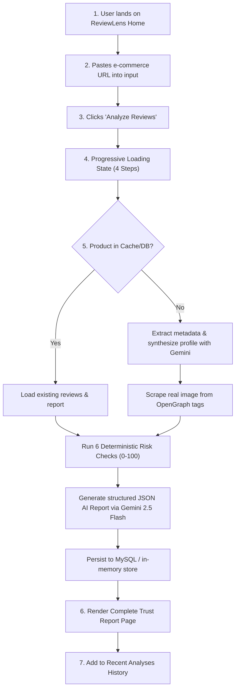

# Product Requirements Document (PRD): ReviewLens

## 1. Product Positioning & Target Persona
- **Product Name:** ReviewLens
- **Tagline:** Know if the reviews can be trusted.
- **Positioning Statement:** ReviewLens is a transparent, AI-powered review trust checker for online shoppers. It highlights potential review-manipulation signals and explains them in plain language, acting as a consumer decision-support tool rather than an absolute fraud detector.
- **Primary Persona:** **Riya**, an online shopper about to purchase a 4.6-star gadget. Before spending money, she wants to verify if the high rating is authentic, what verified buyers are complaining about, and whether recent reviews show signs of artificial inflation.

---

## 2. Core User Journey

### Detailed Journey Steps:
1. **Entry & Input:** User opens the ReviewLens homepage, pastes any e-commerce product URL into the prominent input field, or uses the one-click clipboard button.
2. **Analysis Initiation:** User clicks "Analyze Reviews".
3. **Loading Feedback:** A dedicated loading screen displays four sequential progressive status indicators:
   - *"Reading product details..."*
   - *"Analyzing review patterns..."*
   - *"Checking rating balance and reviewer behavior..."*
   - *"Generating AI trust report..."*
4. **Data Retrieval & Image Extraction:** The system queries the local database. If new, it scrapes live metadata (`og:image`, `twitter:image`, JSON-LD) for real product photos and synthesizes customer review profiles using Google Gemini.
5. **Algorithmic Evaluation:** The backend deterministic engine computes the 0–100 Trust Score based on 6 mathematical integrity rules.
6. **AI Synthesis:** Google Gemini 2.5 Flash receives the calculated evidence and reviews, outputting a grounded JSON report.
7. **Report Presentation:** The user views the complete Review Trust Report, including circular score ring, AI summary, evidence badges, interactive charts, and review list.
8. **Session History:** The evaluation is added to the "Recent Analyses" panel for one-click re-inspection.

---

## 3. UI Requirements & Page Structure

### Page 1: Home / Input Section
- **Header:** Clean branding with search lens icon and live model badge (`Gemini 2.5 Flash`).
- **Hero Area:**
  - Headline: *"Know if the reviews can be trusted."*
  - Subtitle: *"Paste a product link and get an AI-powered review trust report."*
  - URL input with clipboard paste button and validation.
  - Primary action button: *"Analyze Reviews"* (blue `#2563EB`).
- **Value Cards:** Three feature highlights:
  1. *Detect suspicious review patterns*
  2. *Understand real customer feedback*
  3. *Make a confident buying decision*
- **Recent Analyses Carousel:** Interactive history cards showing product image, name, store, trust score badge, and timestamp.
- **Footer:** Responsible AI disclaimer and proof-of-concept statement.

### Page 2: Analysis Loading State
- Clean, non-blocking animated card with spinning indicator.
- Step-by-step progressive messages reflecting actual processing stages.
- Subtle skeleton loaders.

### Page 3: Trust Report Dashboard
- **Top Section (Product & Score):**
  - Real product thumbnail image with store origin tag (Amazon, Flipkart, Myntra, etc.).
  - Product title, average star rating, and review count.
  - Large circular SVG score ring displaying:
    - Numerical Trust Score (0–100)
    - Trust Level Badge: **High Trust** (80–100), **Moderate Trust** (60–79), **Low Trust** (40–59), **Very Low Trust** (0–39)
- **Middle Section (AI Trust Report):**
  - Plain-language shopper explanation generated by Gemini.
  - Bulleted lists of **Main Positive Themes** and **Main Complaints**.
  - **Buyer Recommendation** box with actionable advice.
  - Mandatory AI disclaimer badge: *"AI-generated summary based on available review signals."*
- **Evidence Section (Deterministic Risk Signals):**
  - 6 risk-signal cards with severity pills (`low`, `medium`, `high`) and exact point deductions.
  - Concrete evidence strings (e.g. *"Reviews distributed evenly over time; max 48-hour velocity is 1 reviews"*).
- **Charts Section (Data Visualizations):**
  - **Rating Distribution:** Recharts BarChart showing 1★ to 5★ counts.
  - **Review Timeline:** Recharts LineChart displaying review counts and rating trends over time.
  - **Verified vs. Unverified Purchases:** Recharts Donut PieChart showing buyer integrity ratio.
- **Reviews Section:**
  - Full list of evaluated customer reviews.
  - Reviewer name, star rating, review date, and verified purchase badge.
  - Subtle "Flagged signal" pill if the review contributed to a detected risk anomaly.

---

## 4. Edge Cases & Error Handling
- **Empty / Invalid URL:** Friendly client-side error toast guiding the user to enter a valid link.
- **Live Image Fallback:** If an e-commerce site blocks OpenGraph scraping, the system falls back to semantic product category illustrations.
- **Gemini Offline / Rate Limit:** If the AI API fails, the backend automatically generates a comprehensive rule-based report from the deterministic score signals so the user experience never breaks.
- **Database Disconnection:** If the MySQL database is unreachable, the system transparently utilizes its high-fidelity in-memory seed dataset.

---

## 5. Two-Member Team Collaboration & Ownership
ReviewLens was designed, built, tested, and documented by **two team members**:
- **Team Member 1:** Thulasiram Egowda ([@thulasiramegowda](https://github.com/thulasiramegowda))
- **Team Member 2:** `[Teammate Name]` (`@[teammate-github-username]`)

### Areas of Collaborative Ownership:
- **Product Definition & Requirements:** Jointly scoped the core user persona (Riya), the 6 mathematical risk checks, and the reporting UI layout.
- **Frontend & Visual Design:** Implemented the minimalist light-mode SaaS interface, circular SVG progress ring, and Recharts components.
- **Backend & Algorithm Engineering:** Built the deterministic scoring engine, Gemini 2.5 Flash structured prompt pipeline, and live OpenGraph image scraper.
- **Testing, Verification & Submission:** Conducted multi-store URL testing, verified zero-secret security across Git branches, and drafted submission documentation.
*(Specific individual role distributions are open to final confirmation by both team members).*
