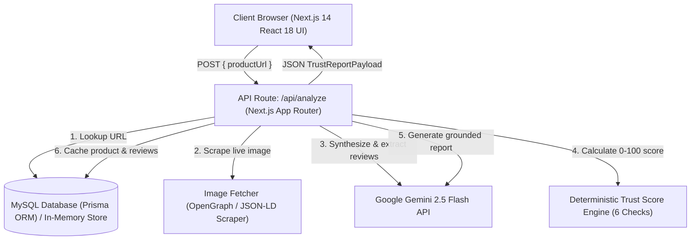

# Technical Specification: ReviewLens

## 1. System Architecture



---

## 2. Technology Stack & Dependencies

| Layer | Technology | Purpose |
| :--- | :--- | :--- |
| **Framework** | Next.js 14.2.24 (App Router) | Full-stack serverless framework for UI and API endpoints |
| **Language** | TypeScript 5.6.3 | End-to-end type safety across frontend and backend |
| **Styling** | Tailwind CSS 3.4.14 | Minimalist light-mode SaaS UI (Linear / Stripe inspired) |
| **Database & ORM** | Prisma ORM 5.22.0 + MySQL | Relational data persistence with connection pooling |
| **Data Fallback** | In-Memory Object Store | Zero-downtime offline fallback when DB is disconnected |
| **AI Integration** | `@google/generative-ai` 0.24.0 | Structured review synthesis via `gemini-2.5-flash` |
| **Data Visualization**| Recharts 2.13.0 | Rating distribution, timeline, and verified buyer charts |
| **Schema Validation**| Zod 3.23.8 | Strict schema validation for API inputs and AI JSON responses |
| **Icons** | Lucide React 0.460.0 | High-clarity UI icons |

---

## 3. Database Schema (Prisma MySQL)

```prisma
datasource db {
  provider = "mysql"
  url      = env("DATABASE_URL")
}

model Product {
  id            String          @id @default(uuid()) @db.VarChar(191)
  url           String          @unique @db.VarChar(191)
  name          String          @db.VarChar(255)
  imageUrl      String?         @db.Text
  store         String          @db.VarChar(100)
  averageRating Float
  reviewCount   Int
  createdAt     DateTime        @default(now())
  reviews       Review[]
  analyses      AnalysisCache[]

  @@map("products")
}

model Review {
  id                 String   @id @default(uuid()) @db.VarChar(191)
  productId          String   @db.VarChar(191)
  reviewerName       String   @db.VarChar(191)
  rating             Int
  comment            String   @db.Text
  isVerifiedPurchase Boolean
  reviewDate         DateTime
  createdAt          DateTime @default(now())

  product Product @relation(fields: [productId], references: [id], onDelete: Cascade)

  @@index([productId])
  @@map("reviews")
}

model AnalysisCache {
  id             String   @id @default(uuid()) @db.VarChar(191)
  productId      String   @db.VarChar(191)
  trustScore     Int
  trustLevel     String   @db.VarChar(50)
  geminiResponse Json
  riskSignals    Json
  createdAt      DateTime @default(now())

  product Product @relation(fields: [productId], references: [id], onDelete: Cascade)

  @@index([productId])
  @@map("analysisCache")
}
```

> **Note on MySQL Compatibility:** Column lengths on unique indexes are explicitly set to `@db.VarChar(191)` to ensure compatibility with MySQL's `utf8mb4` index key limit of 767 bytes (191 × 4 = 764 bytes).

---

## 4. API Endpoints

### 1. `POST /api/analyze`
- **Request Body:** `{ "productUrl": "https://www.amazon.in/dp/..." }`
- **Logic:**
  1. Validates `productUrl` with Zod.
  2. Queries DB for cached product. If found, returns existing analysis.
  3. If new URL:
     - Fetches live image via `fetchProductImageFromUrl()` in `src/lib/imageFetcher.ts`.
     - Synthesizes 30 representative customer reviews via `synthesizeProductAndReviewsFromUrl()` in `src/lib/gemini.ts`.
     - Executes `analyzeReviewsDeterministically()` in `src/lib/trustEngine.ts`.
     - Synthesizes structured plain-language AI report via `generateAiTrustReport()`.
     - Persists new product, reviews, and cached analysis into MySQL (or memory store).
- **Response:** `200 OK` with unified `TrustReportPayload` JSON.

### 2. `GET /api/health`
- **Response:** `{ "status": "ok", "app": "ReviewLens", "geminiConfigured": true, "version": "1.0.0", "timestamp": "..." }`

### 3. `GET /api/products`
- **Response:** List of seeded and analyzed products with ratings and image URLs.

### 4. `GET /api/products/[id]`
- **Response:** Detailed product entity with full review array and latest cached trust score.

---

## 5. Deterministic Trust Score Engine Formulation

The trust score begins at **100 points** and applies transparent deductions based on 6 mathematical rules:

$$\text{Trust Score} = 100 - \sum_{i=1}^{6} D_i$$

Where each deduction $D_i$ is bounded:
1. **Review Velocity Burst ($D_1 \le 25$):** Evaluates rolling 48-hour windows. If $\ge 35\%$ of total reviews or $\ge 14$ reviews occur in one window, deduct up to 25 points.
2. **Duplicate & Templated Wording ($D_2 \le 20$):** Normalizes text, tokenizes into word sets, and runs Jaccard-style similarity clustering. Deducts 5 points per cluster with $\ge 70\%$ word overlap (capped at 20).
3. **Unverified Purchase Ratio ($D_3 \le 20$):**
   - If unverified ratio $\ge 70\%$, deduct 20 points.
   - If unverified ratio $\ge 40\%$, deduct 12 points.
   - If unverified ratio $\ge 20\%$, deduct 6 points.
4. **Rating Distribution Imbalance ($D_4 \le 20$):**
   - 5-star concentration $\ge 85\%$: deduct 20 points.
   - 5-star concentration $\ge 70\%$: deduct 10 points.
   - Bimodal polarization (1★ + 5★ $> 80\%$ with middle $< 15\%$): deduct 15 points.
5. **Reviewer Identity Repetition ($D_5 \le 10$):** Counts duplicate reviewer names on the same product. Deducts 5 points per repeat (capped at 10).
6. **Rating Divergence ($D_6 \le 5$):** If $|\bar{R}_{\text{verified}} - \bar{R}_{\text{unverified}}| \ge 1.8\star$, deduct 5 points.

---

## 6. Security & Secret Protection
- **No Client Secrets:** `GEMINI_API_KEY` and `DATABASE_URL` are strictly server-side environment variables.
- **Git Protection:** `.gitignore` enforces `.env` and `.env.*` exclusion. Only `.env.example` with non-sensitive placeholders is tracked in version control.
- **Audited History:** Zero credentials or secrets exist in any Git commit or PR branch.

---

## 7. Two-Member Technical Implementation
- **Co-Engineered By:** Thulasiram Egowda ([@thulasiramegowda](https://github.com/thulasiramegowda)) and `[Teammate Name]` (`@[teammate-github-username]`).
- Both team members verified the deterministic score calculations, Gemini grounding schemas, and full-stack local builds.
